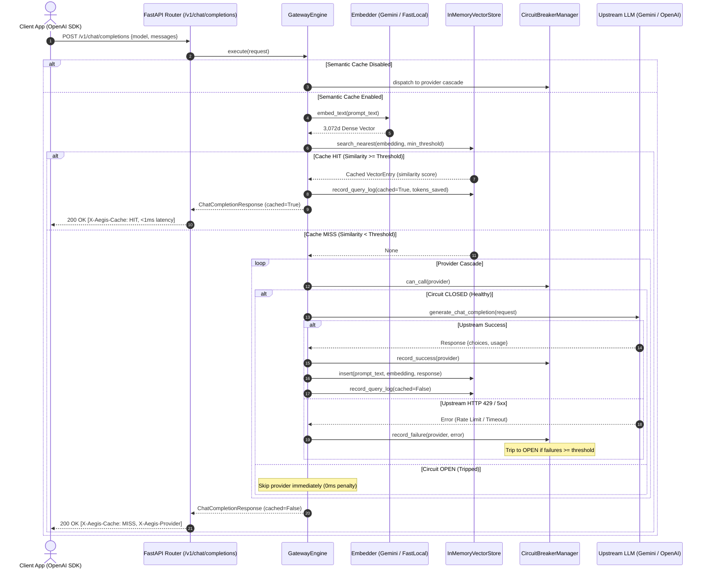

# Request Execution Lifecycle

This document provides a deep, step-by-step walkthrough of what happens inside Aegis when an inference request hits the `/v1/chat/completions` endpoint.

---

## Detailed Sequence Diagram



---

## Phase-by-Phase Execution Breakdown

### Phase 1: Ingestion & Canonical Prompt Extraction
When a POST request arrives at `/v1/chat/completions`:
1. **Schema Validation:** FastAPI validates the payload against Pydantic model `ChatCompletionRequest`.
2. **Canonical Prompt Serialization:** The engine calls `request.get_prompt_text()`. It iterates through the message history and formats:
   ```text
   user: How do I configure Docker container networking?
   ```
   This canonical representation ensures consistent embedding coordinates regardless of message packaging.

### Phase 2: High-Dimensional Vectorization
1. Aegis invokes the configured embedder (`GeminiEmbedder` or `FastLocalEmbedder`).
2. The prompt is converted into a floating-point vector (e.g. 3,072 dimensions via `gemini-embedding-001`).
3. For Gemini embeddings, Aegis uses a resilient connection pool with a 20-second timeout.

### Phase 3: In-Memory Cosine Similarity Scan
1. The query vector is compared against all active entries in `InMemoryVectorStore`.
2. Because all stored embeddings are normalized to unit length upon insertion ($\|v\|=1$), the similarity computation collapses to a fast dot product:
   ```python
   score = np.dot(query_norm, entry.embedding)
   ```
3. Entries exceeding their Time-To-Live (`ttl_seconds`, default 24h) are filtered out automatically.
4. If `best_score >= min_threshold` (e.g. `0.85`), the request transitions to the **Cache Hit Branch**. Otherwise, it proceeds to the **Cache Miss Branch**.

### Phase 4A: Cache Hit Branch (Sub-Millisecond Return)
1. **Response Reconstruction:** The cached completion text and original token counts are packaged into a standard `ChatCompletionResponse`.
2. **Hit Counters Incremented:** `best_entry.hit_count += 1`, `_total_hits += 1`, and `_total_tokens_saved += tokens`.
3. **Telemetry Logging:** An entry is prepended to the rolling query feed:
   ```python
   {
       "time": "19:29:20",
       "prompt": "user: How to configure Docker container networking?",
       "cached": True,
       "provider": "aegis_semantic_cache",
       "latency_ms": 0.18,
       "tokens_saved": 22
   }
   ```
4. **Header Injection:** FastAPI injects tracing headers (`X-Aegis-Cache: HIT`, `X-Aegis-Latency-Ms: 0.18`).
5. **Client Return:** Delivered to client in $<1\text{ ms}$.

### Phase 4B: Cache Miss & Upstream Cascade
1. **Circuit Breaker Check:** The engine iterates through the configured provider cascade:
   ```python
   ["gemini", "openai", "mock"]
   ```
2. **Fast-Fail Bypassing:** For each provider, `circuit_breaker.can_call(provider)` is evaluated. If a provider's circuit is `OPEN` (tripped), Aegis skips it instantly with 0 ms waiting time.
3. **Upstream Inference:** The first available provider receives the inference request.
4. **On Success:**
   * Circuit breaker records success (`record_success(provider)`), resetting consecutive failure counters.
   * **Cache Population:** The response is asynchronously inserted into the vector store alongside its precomputed embedding vector.
   * Telemetry logs a `cached=False` entry in the rolling feed.
5. **On Upstream Failure (HTTP 429 / 5xx):**
   * Circuit breaker records failure (`record_failure(provider, error)`).
   * If failure threshold is reached (e.g. 3 consecutive failures), the circuit state trips to `OPEN`.
   * Aegis falls back immediately to the next provider in the chain.
