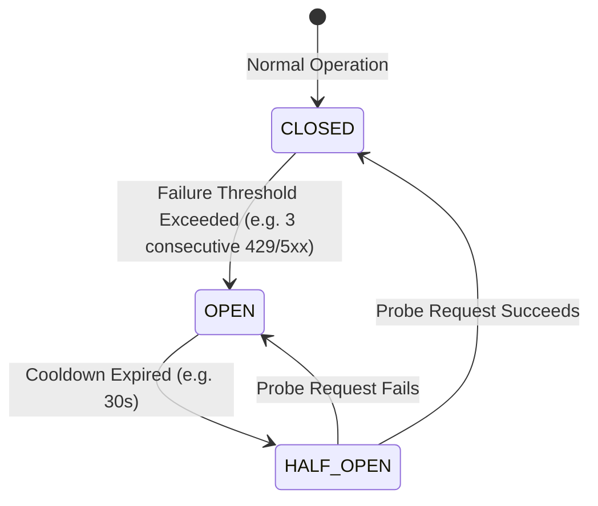

# Circuit Breaker & Multi-Model Failover

Production AI systems frequently encounter upstream provider failures:
* **HTTP 429:** Rate limits during unexpected traffic surges.
* **HTTP 503 / 504:** Upstream LLM provider capacity degradation or regional outages.
* **Latency Spikes:** Upstream inference queues causing timeouts.

Aegis implements an automated **Three-State Circuit Breaker** pattern per provider.

---

## Circuit Breaker State Machine



### States:
* **`CLOSED` (Healthy):** Requests route normally to the provider. Consecutive failure counter is reset on every successful call.
* **`OPEN` (Tripped):** Provider has breached failure thresholds. All requests immediately bypass this provider with 0 ms waiting time, cascading to the next provider in the fallback chain.
* **`HALF_OPEN` (Probing):** Once the cooldown timer expires, a trial probe request is allowed through. If it succeeds, the circuit recovers to `CLOSED`. If it fails, the circuit re-opens for another cooldown period.

---

## Multi-Model Cascade

When a primary provider's circuit is `OPEN`, Aegis routes through the configured `provider_cascade`:

```python
provider_cascade = ["gemini", "openai", "local_fallback"]
```

1. **Attempt 1:** Check if `gemini` circuit is `CLOSED`. If open, skip immediately.
2. **Attempt 2:** Route to `openai` (`gpt-4o-mini`).
3. **Attempt 3:** Route to `local_fallback` if both cloud providers are unavailable.

Clients experience zero downtime and receive clean responses without being exposed to 429 rate limit errors.
