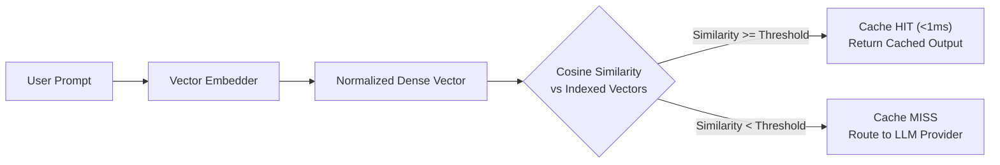

# Dense Semantic Vector Caching

Traditional caching systems (e.g. Redis key-value or LRU caches) match requests based on exact string equality or MD5 hash keys. In natural language interfaces, this pattern breaks down because users ask for the exact same information with different phrasing:

* **Query 1:** *"How do I configure bridge networking in Docker containers?"*
* **Query 2:** *"Setting up Docker bridge network configuration guide"*

To an exact-string cache, these are two separate cache misses, causing unnecessary LLM API calls and latency spikes.

---

## How Aegis Solves This

Aegis implements **Dense Semantic Vector Caching**:

1. **Vector Embedding:** Incoming prompt text is converted into a high-dimensional vector.
   * `gemini`: Uses Google Gemini `gemini-embedding-001` (3,072 dimensions) for rich semantic understanding.
   * `fast_local`: Sub-millisecond subword n-gram vectorizer for offline development and micro-benchmarks.
2. **Vector Normalization:** Embeddings are normalized to unit length upon insertion:
   $$\hat{v} = \frac{v}{\|v\|_2}$$
3. **Dot-Product Cosine Similarity:** In normalized vector space, cosine similarity is computed with a single dot product:
   $$\text{sim}(u, v) = u \cdot v$$
4. **Threshold Evaluation:** If the highest similarity score exceeds the configured `SIMILARITY_THRESHOLD` (default `0.85`), Aegis intercepts the request and returns the cached completion in $<1\text{ ms}$.

---

## Sensitivity Tuning

You can adjust the similarity threshold based on your application's domain:

* **`0.88 - 0.92` (Strict):** Recommended for code generation, mathematics, or factual QA where precision is paramount.
* **`0.80 - 0.85` (Balanced):** Recommended for customer support chatbots, search queries, and documentation lookups.
* **`< 0.80` (Aggressive):** Maximum token savings; higher risk of returning loosely related completions.
