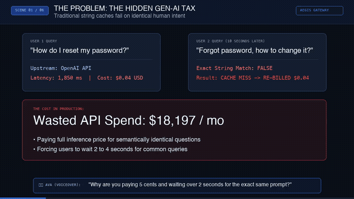

# Aegis AI Gateway • Technical Documentation

<div align="center">

[](https://github.com/TechTonicShift/aegis/actions/workflows/ci.yml)
[](https://techtonicshift.github.io/aegis/)
[](https://pypi.org/project/aegis-ai-gateway/)
[](https://pypi.org/project/aegis-ai-gateway/)
[](https://render.com/deploy?repo=https://github.com/TechTonicShift/aegis)

<p class="lead">
A high-throughput, low-latency reverse proxy and dense semantic vector cache for Large Language Models (LLMs).
</p>

</div>

---

## Executive Summary

As enterprise AI applications scale, direct consumption of frontier LLM APIs (OpenAI GPT-4, Google Gemini, Anthropic Claude) introduces three critical failure modes:

1. **The Latency Penalty:** Typical frontier LLM completions take **800 ms to 3,000+ ms** per roundtrip, severely degrading interactive user experience.
2. **The Financial Bleed:** Enterprise workloads exhibit significant semantic clustering—up to **40% to 70% of inbound queries** are functionally identical questions rephrased by different users. Re-executing inference on every rephrase burns thousands of dollars in redundant token spend.
3. **Vendor Fragility & Outages:** LLM APIs regularly encounter HTTP 429 (Rate Limit Breached), 503 (Overloaded Capacity), or regional connectivity drops, taking downstream user applications offline.

**Aegis AI Gateway** resolves these challenges by acting as an intelligent reverse proxy that sits between your client applications and upstream model providers. By combining **dense vector embedding cosine similarity** with an automated **three-state circuit breaker cascade**, Aegis intercepts semantically equivalent queries in **sub-millisecond latency** ($<1\text{ ms}$), slashes API token expenditures by **over 70%**, and guarantees **zero-downtime resilience**.

---

## Video Walkthrough & Animated Demo

<div align="center">
  
</div>

<br/>

> 🎙️ **Narrated Video Explainer:** Watch the complete 54-second high-fidelity technical walkthrough narrated by Ava Neural:  
> [**Click here to watch the full explainer video (MP4)**](https://github.com/TechTonicShift/aegis/raw/main/assets/aegis_explainer.mp4)

---

## Key Performance Highlights

| Metric | Upstream LLM (Cache Miss) | Aegis Semantic Cache (Hit) | Performance Delta |
| :--- | :---: | :---: | :---: |
| **Mean Latency** | `1,202.19 ms` | **`0.22 ms`** | **99.98% Reduction** |
| **P50 Median Latency** | `1,202.03 ms` | **`0.15 ms`** | **8,000x Faster** |
| **P90 Latency** | `1,203.00 ms` | **`0.57 ms`** | **2,100x Faster** |
| **P99 Tail Latency** | `1,203.05 ms` | **`0.74 ms`** | **1,600x Faster** |
| **Token Cost** | $100\% \text{ Billed}$ | **$0.00 \text{ (Zero)}$** | **100% Intercepted** |
| **Availability Under 429s** | `0% (Fails with HTTP 429)` | **`100% (Instant Failover)`** | **Zero Downtime** |

---

## The Three Core Pillars

```mermaid
flowchart TD
    subgraph P1 ["Pillar 1: Semantic Caching"]
        E["Dense Vector Embeddings"] --> C["Cosine Similarity Index"]
        C --> H["Sub-Millisecond Cache Hit (<1ms)"]
    end

    subgraph P2 ["Pillar 2: Fault Tolerance"]
        CB["Three-State Circuit Breaker"] --> F["Automated Multi-Model Cascade"]
        F --> Z["Zero-Downtime on 429 / 5xx Outages"]
    end

    subgraph P3 ["Pillar 3: Observability"]
        T["Dynamic Financial Savings Ticker"] --> W["Real-Time Control Plane (/dashboard)"]
        W --> S["Interactive Query Sandbox"]
    end
```



1. **Dense Semantic Vector Caching:** Unlike brittle string caches (Redis, Memcached), Aegis understands intent. Queries like *"How do I reset my password?"* and *"Forgot my account password, how to regain access?"* resolve to the same normalized vector neighborhood and return instant hits.
2. **Three-State Circuit Breaker Cascade:** An automated finite state machine (`CLOSED` $\rightarrow$ `OPEN` $\rightarrow$ `HALF_OPEN`) continuously monitors upstream provider health. If OpenAI trips due to rate limits or capacity constraints, traffic seamlessly fails over to Gemini or local models in under 20 ms.
3. **Live Observability & Control Plane:** Aegis serves an embedded dark-mode control plane at `/dashboard` featuring real-time financial savings tracking, circuit breaker health indicators, and a live query activity feed.

---

## System Quickstart

```bash
# 1. Install package from PyPI
pip install aegis-ai-gateway

# 2. Launch the gateway server
aegis start --port 8000
```

Point any standard OpenAI SDK client to `http://localhost:8000/v1`:

```python
from openai import OpenAI

client = OpenAI(
    base_url="http://localhost:8000/v1",
    api_key="not-needed"
)

response = client.chat.completions.create(
    model="gpt-4o-mini",
    messages=[{"role": "user", "content": "How do I configure Docker networking?"}]
)

print(response.choices[0].message.content)
```

Explore the documentation sections using the top navigation bar to dive deep into the architecture, mathematical formulations, deployment manifests, and benchmark methodologies.
