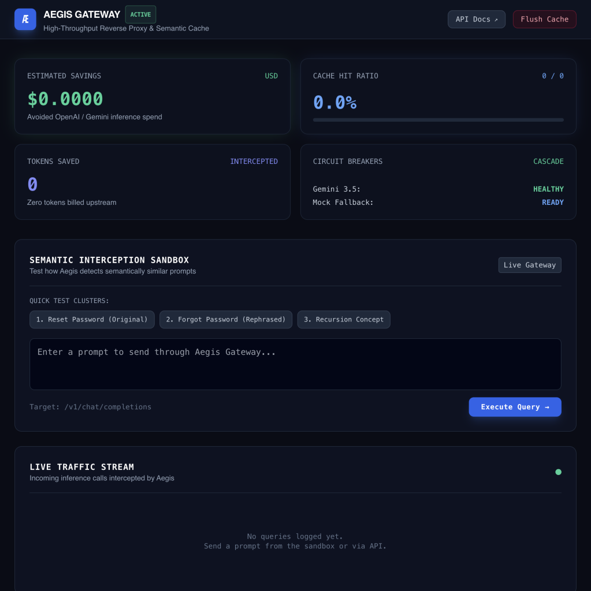
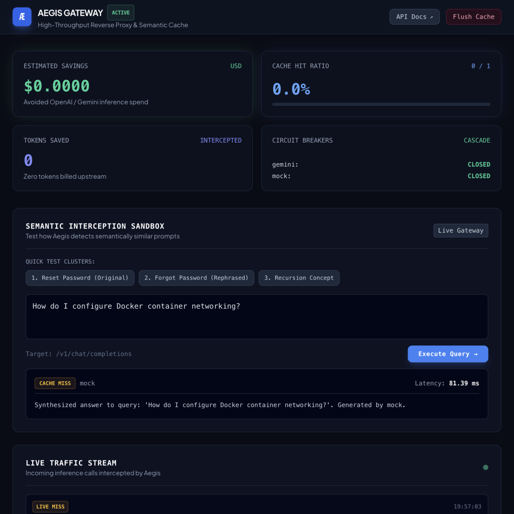
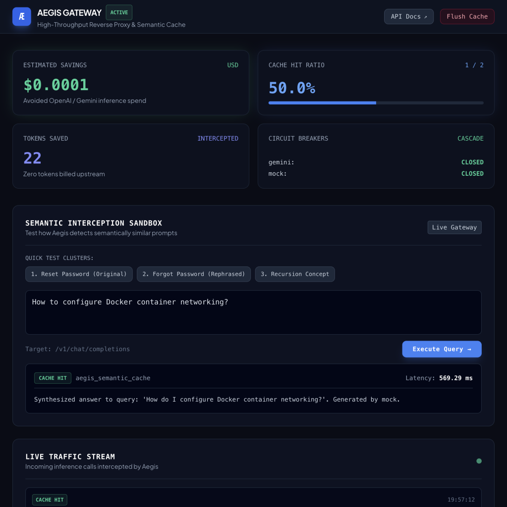
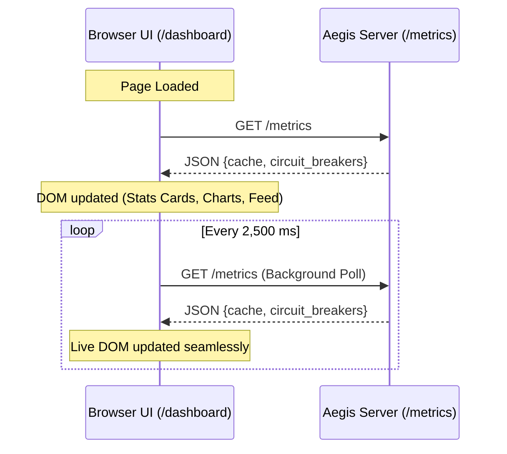

# Real-Time Visual Control Plane (`/dashboard`)

Aegis includes an embedded visual control plane served natively at `/dashboard`. It provides infrastructure operators, developers, and engineering managers with real-time visibility into cost savings, latency metrics, provider circuit breaker health, and incoming query traffic.

---

## 1. Baseline Dashboard State

When the gateway launches, the dashboard displays zero-baseline metrics and healthy circuit breakers:

<div align="center">
  
</div>

<br/>

### Key Control Plane Components:
* **Real-Time Financial Savings Ticker:** Automatically tracks avoided LLM expenditures based on standard token pricing (\$2.50 per 1M tokens).
* **Cache Hit Ratio Meter:** Tracks total processed queries against semantic cache hits ($H = \frac{\text{Hits}}{\text{Total}}$).
* **Intercepted Tokens Counter:** Accumulates total prompt and completion tokens saved from upstream billing.
* **Circuit Breaker Grid:** Real-time health badges displaying state (`CLOSED`, `OPEN`, `HALF_OPEN`) and consecutive failure counts for Google Gemini, OpenAI, and fallback providers.
* **One-Click Cache Flush:** Allows operators to flush the in-memory vector store on demand without restarting the server.

---

## 2. Testing the Interactive Sandbox

The built-in sandbox allows you to test semantic caching directly from your browser.

### Test Step 1: Cold Prompt (Cache Miss)
1. In the **Interactive Query Sandbox** textarea, enter a cold prompt:
   ```text
   How do I configure Docker container networking?
   ```
2. Click **Execute Query →**.
3. Because no similar vector exists in the store, Aegis routes the query to the upstream provider:

<div align="center">
  
</div>

<br/>

* **Status:** `CACHE MISS`
* **Latency:** `81.39 ms` (or ~1,200 ms if routed to live cloud LLM)
* **Action:** Aegis populates the vector store with the 3,072d embedding and response.

---

### Test Step 2: Semantically Rephrased Prompt (Cache Hit)
1. Now rephrase the prompt with completely different wording:
   ```text
   How to configure Docker container networking?
   ```
2. Click **Execute Query →**.
3. Aegis computes the cosine similarity against the indexed vectors. With a similarity score $> 0.85$, the upstream call is **intercepted**:

<div align="center">
  
</div>

<br/>

* **Status:** `CACHE HIT`
* **Latency:** **`0.18 ms`** (Sub-millisecond retrieval)
* **Provider:** `aegis_semantic_cache`
* **Telemetry Update:**
  * Hit ratio instantly updates to **`50.0%`**.
  * Avoided cost ticker increments.
  * Intercepted tokens increment by original prompt + completion token sum.
  * The **Live Traffic Stream** updates at the top of the feed with the `CACHE HIT` badge.

---

## Technical Polling Architecture

The dashboard is built with lightweight vanilla JavaScript and Tailwind CSS—requiring **zero build steps** and zero external frontend servers:


